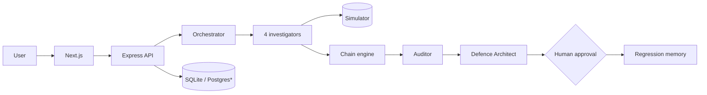

# SellerShield AI

**Discover. Connect. Verify. Defend. Remember.** — a merchant-side security testing and financial-resilience prototype (PayPal AI Hackathon 2026).

> SellerShield AI is **not** a PayPal product, is not endorsed or certified by PayPal, and does not predict real fraud. All attacks run in an isolated local simulator against a sample shop; all dollar figures are **simulated projections**.

## 1. Introduction
Six cooperating agents examine a controlled sample merchant (**NovaCart Electronics**), chain weaknesses into compound attacks, an Independent Auditor reproduces every claim, a Defence Architect produces real code diffs, and a regression memory catches fixes that silently regress.

## 2. Problem
Merchants lose money to *combinations* of small logic flaws (stackable coupons + list-price refunds + replayable refund requests). Isolated checks report them separately; AI findings are often unverified.

## 3. Solution overview
Discover → connect into a proven attack chain → verify independently → defend with a human-approved diff → replay the attack → remember.

## 4. Key features
Six-agent pipeline · compound attack chains with an interactive graph · deterministic simulator (13 scenarios) · transparent financial exposure (low/expected/high) · independent verification · patch lifecycle with approval, confirmation, rollback · regression memory · PayPal Sandbox integration with webhook verification *(untested live)* · public-website observation mode · JSON/PDF reports.

> **Authoritative status: [docs/FINAL_HACKATHON_VALIDATION.md](docs/FINAL_HACKATHON_VALIDATION.md)** (what is live-verified, mock-tested, blocked or untested).

## 4b. New: Discovery Lab, PayPal Red Team, Defence-as-PR
See [docs/NEW_FEATURES.md](docs/NEW_FEATURES.md). (1) **PayPal Red Team** attacks the Orders/Payments protocol and reconciles NovaCart's ledger against PayPal's refund records; (2) **Attack Discovery Lab** lets an LLM tool-use attacker or a deterministic search invent attack sequences that are independently replayed and verified (it finds *Cancel-for-Cash*, not in the scripted library); (3) **Defence-as-PR** opens a *draft* GitHub PR with the patch, a runnable regression test and proof. **Real-service status: PayPal Sandbox (OAuth + red-team phase A) and Groq (tool calling, failover, one real discovery session) are verified live; Gemini is blocked by a billing restriction; a real draft GitHub PR was opened in a dedicated test repo and checked via the GitHub API (2026-11-10); real PayPal webhook signature verification is verified on 3 Sandbox deliveries.**

## 5. Six-agent architecture
| Agent | Role |
|---|---|
| Opportunist | discounts, coupons, pricing |
| Refund Abuse | refunds, cancellations |
| Payment Manipulation | payment states, idempotency, webhook replay, concurrent checkout |
| Insider Threat | staff roles, approvals, audit |
| Defence Architect | patch, plan, trade-offs, dry-run for each verified vulnerability |
| Independent Auditor | reproduces claims/chains, may reject, validates defences |
Details: [docs/AGENT_ARCHITECTURE.md](docs/AGENT_ARCHITECTURE.md). Agents are scenario-driven; an optional LLM may only reorder probes.

## 6. Compound attacks (verified in the simulator)
- **Discount-Stack Refund Siphon**: customer pays $126 (3 stacked coupons), refund pays $200, correct outcome keeps $80 → **$154 per attack**; the same weaknesses exploited separately total **$84**.
- **Phantom Payment Insider Payout**: pending-then-denied payment ships goods; an intern refunds the unreceived $120 → **$240 per attack** (isolated $210).

## 7. Independent Auditor
Re-reproduces each claim twice from fresh state, checks ledger invariants, recomputes exposure, may correct severity. Tests show it rejects an inflated claim, an unknown test case and an attack that no longer reproduces.

## 8. Patch lifecycle
Generate (unified diff of the vulnerable vs secure rule source) → review → **approve** → **explicit confirmation** → apply to the **demo app only** → regression tests (original attack blocked, legitimate flows, no new exploits, chain re-check) → rollback available.

## 9. Regression memory
Stores vulnerabilities, sequences, fixes and tests per merchant. A business-rule change that disables a fix + **Rerun previous tests** ⇒ the vulnerability is flagged *reintroduced*.

## 10. Technology stack
Next.js 15 · React 19 · Tailwind · React Flow · Recharts · Express 4 · TypeScript · Zod · Prisma 6 · **SQLite** (default) · pdfkit · cheerio · vitest/supertest · puppeteer-core (E2E). Optional: Gemini and Groq (OpenAI-compatible) LLMs with failover, PayPal REST (Sandbox).

## 11. System architecture
See [docs/SYSTEM_ARCHITECTURE.md](docs/SYSTEM_ARCHITECTURE.md) for the full Mermaid diagram.

\*PostgreSQL untested.

## 12–15. Install, configure, database, run
Full guide: [docs/INSTALLATION_GUIDE.md](docs/INSTALLATION_GUIDE.md).
```bash
cd backend && npm install && cp ../.env.example .env && npm run db:push && npm start   # :4000
cd frontend && npm install && npm run build && npm start                                # :3000
```
Environment variables: see `.env.example` (never commit `.env`). Database: SQLite file `prisma/dev.db` created by `db:push`. PostgreSQL steps exist but are unverified.

## 16. Demo
Open http://localhost:3000 → **Explore Live Demo** → **Reset demo** → **Run Live Demo** (~15 s). Script: [docs/SELLERSHIELD_LIVE_DEMO_SCRIPT.md](docs/SELLERSHIELD_LIVE_DEMO_SCRIPT.md). No PayPal or AI credentials needed.

## 17. Testing
| Command | What | Last result (2026-11-08) |
|---|---|---|
| `cd backend && npm test` | 117 tests (simulator, unit, API integration, new features, LLM failover mocks, test-isolation guard) | 117/117 pass |
| `cd backend && npm run build` | type-check | pass |
| `cd frontend && npm run build` | production build | pass |
| `cd e2e && npm install && node e2e.js` | 26 headless-Chrome checks (servers must run) | 26/26 pass |
Full report: [docs/FINAL_TECHNICAL_VALIDATION.md](docs/FINAL_TECHNICAL_VALIDATION.md).

## 18. Limitations (summary — see [docs/KNOWN_LIMITATIONS.md](docs/KNOWN_LIMITATIONS.md))
Deployed on Render with PostgreSQL (free tier; the live red team ran against it); the local test suite is not yet run on PostgreSQL · PayPal Sandbox: OAuth, orders, approval, capture, refund, idempotency and over-refund probes verified live; webhook signature verification verified live on 3 Sandbox deliveries (a real Resend was delivered and not stored twice) · Gemini disabled by default (billing); Groq tool-calling and two real discovery sessions verified live ([docs/LLM_LIVE_VALIDATION.md](docs/LLM_LIVE_VALIDATION.md)); real GitHub draft PR verified once, in a dedicated test repo · default demo uses the deterministic planner · simulation covers NovaCart only · website mode = public pages only · uploads stored inert, not analysed · no frontend unit tests/lint · in-process jobs · dependency advisories not upgraded.

## Screenshots
`docs/screenshots/` — real captures: landing, live demo, six agents, patch diff, attack blocked, dashboard, attack-chain explorer, financial impact, vulnerability evidence, defence center, regression memory, report, PayPal (demo mode).

## 19. Future scope
Second simulated app and platform adapters · source-aware analysis of uploaded sandbox repos · PostgreSQL + queue workers · merchant-calibrated financial model · live Sandbox/AI CI.

## 20. Contributors
`[Team name]` — `[Member 1]`, `[Member 2]`, `[Member 3]` (placeholders).

## Documentation index
`docs/PROJECT_ABSTRACT.md`, `SYSTEM_ARCHITECTURE.md`, `AGENT_ARCHITECTURE.md`, `ATTACK-SIMULATOR.md`, `PAYPAL-INTEGRATION.md`, `SECURITY.md`, `THREAT_MODEL.md`, `DEMO_GUIDE.md`, `INSTALLATION_GUIDE.md`, `DEPLOYMENT_GUIDE.md`, `KNOWN_LIMITATIONS.md`, `FINAL_TECHNICAL_VALIDATION.md`, `SELLERSHIELD_HACKATHON_PPT.md` (+ `SellerShield_AI_Hackathon.pptx`), `NEW_FEATURES.md`, `LLM_LIVE_VALIDATION.md`, `FINAL_HACKATHON_VALIDATION.md`, `WEBHOOK_SETUP.md`, `SELLERSHIELD_LIVE_DEMO_SCRIPT.md`, `JUDGE_QUESTIONS_AND_ANSWERS.md`, `GITHUB_READINESS.md`, `COMPETITION_READINESS_CHECKLIST.md`.

## License
MIT. See [LICENSE](LICENSE). Copyright (c) 2026 Sanjay B.
