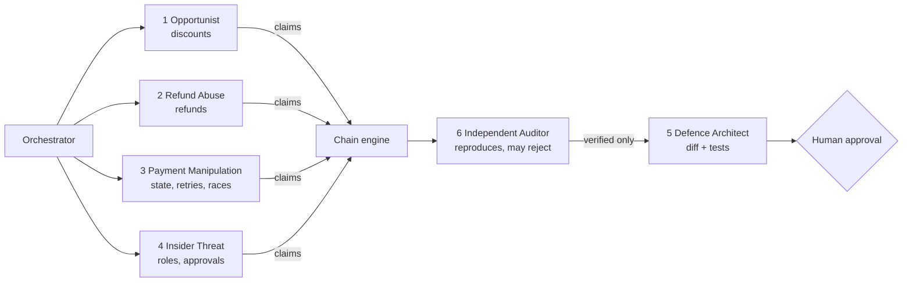

# SellerShield AI — Hackathon Presentation (10 slides)

An editable PowerPoint with the same content and the real screenshots is generated at `docs/SellerShield_AI_Hackathon.pptx` (`node docs/ppt-build/build.js`). Screenshots are real captures from the running app in `docs/screenshots/`.

**Visual identity:** background `#080D19` (near-black navy), panels `#0E1626`, electric blue `#3B82F6`, cyan `#22D3EE`, red `#F87171` for threats, green `#34D399` for verified/blocked. Headlines Segoe UI Semibold / Inter, code in Consolas. One idea and one big number per slide; max ~25 words of body text.

---
## Slide 1 — Title
**SellerShield AI** — *AI-Powered Autonomous E-Commerce Security Platform*
**Discover. Connect. Verify. Defend. Remember.**
Merchant-side security testing and financial-resilience prototype.
Team: `[Team name]` · `[Member 1, role]` · `[Member 2, role]` · `[Member 3, role]`
Stack: Next.js · React Flow · Express/TypeScript · Prisma · Zod · pdfkit · Gemini/Groq (OpenAI-compatible, optional) · PayPal REST (Sandbox, optional)
Visual: `screenshots/00-landing.png`

## Slide 2 — The problem
- Commerce logic fails in **combinations**: a discount rule, a refund formula and a retry path can each look harmless.
- Isolated checks report them as separate low/medium items, not as one money-losing sequence.
- AI-generated findings are often unverified; teams need **evidence and a fix they can trust**.
Big visual: three small icons (coupon, refund, retry) → one red "$" arrow.
Speaker note: we make no claim about what other tools can or cannot do; our focus is the chain, the proof and the fix.

## Slide 3 — Our solution
Five verbs, one pipeline: **Discover** weaknesses → **Connect** them into attack chains → **Verify** independently → **Defend** with a real diff → **Remember** so fixes can't silently regress.
Also: calculated, transparent, *simulated* financial exposure for every finding.
**New:** an Attack Discovery Lab (LLM tool-use attacker or exhaustive search invents attack sequences that are replayed and verified), a PayPal Red Team (probes the Orders/Payments protocol and reconciles our ledger against PayPal's refund records) and Defence-as-PR (verified fixes opened as *draft* GitHub PRs). See `NEW_FEATURES.md`.
Visual: `screenshots/06-dashboard.png`

## Slide 4 — Six-agent architecture

| Agent | Responsibility | Output |
|---|---|---|
| Opportunist | coupon/discount/pricing rules | findings + controls held |
| Refund Abuse | refunds & cancellations | findings + controls held |
| Payment Manipulation | payment states, idempotency, concurrent checkout | findings + controls held |
| Insider Threat | staff roles, approvals, audit | findings + controls held |
| Defence Architect | patch, plan, trade-offs per verified issue | defence proposals + dry-run |
| Independent Auditor | re-reproduce, check ledger, recompute $ | verified / rejected |
Honest note: agents run deterministic probes; an LLM (optional, untested live) may only reorder them.
Visual: `screenshots/02-agents.png`

## Slide 5 — Compound attack intelligence (the big idea)
**Discount-Stack Refund Siphon** (verified in the NovaCart simulator)
1. Stack 3 coupons (SAVE20 + VIP15 + WELCOME10) on 4× $50 → customer pays **$126** (policy allows one coupon → $160)
2. Refund 2 units → engine pays **$100** (list price) instead of a share of what was actually paid
3. Replay the same request → pays **$100 again**
**Collected $126 · refunded $200 · correct outcome: keep $80 → excess $154 per attack.**
Exploited separately: $34 + $20 + $30 = **$84**. Together: **$154**. The discount shrinks what was paid, the refund formula ignores that, the replay doubles it.

**Phantom Payment Insider Payout** (PAY-001 → ACL-001): a PENDING e-check capture marks a $120 order paid and ships goods; the payment is later DENIED; an *intern* account refunds $120 that was never received. Correct outcome $0 · actual −$240 → **$240 per attack** (isolated: $90 + $120 = $210).
All numbers are simulated and labelled as such. Annual projection (assumption-based): Siphon $1,078 low / $4,466 expected / $13,244 high.
Visual: `screenshots/07-attack-chain-explorer.png`

## Slide 6 — Independent Auditor
- A finding is **a claim** until the Auditor reproduces it from a fresh state — twice, with identical outcomes.
- It checks ledger invariants (over-refund, duplicate payout, unsettled shipment …) and recomputes the dollar figure.
- **Rejected in tests:** inflated exposure claim, unknown test case, and an attack that no longer reproduces after a fix. It can also *correct severity*.
- Result: only reproduced findings count as verified.
Visual: `screenshots/09-vulnerability-evidence.png` (evidence + auditor note) and the verdict list on `02-agents.png`.

## Slide 7 — Autonomous defence (human-approved)
Real code from `rules.ts` — vulnerable → secure (`calcRefund`):
```diff
-  const amount = Math.round(line.unitPrice * qty * 100) / 100; // BUG: ignores the discount actually paid
-  if (order.refunded + amount > order.subtotal + 0.005) return { error: 'exceeds_order_value' };
+  // Allocate the discount proportionally, then cap at what is still refundable.
+  const share = (line.unitPrice * qty) / order.subtotal;
+  const remaining = Math.round((order.total - order.refunded) * 100) / 100;
+  const amount = Math.min(Math.round(order.total * share * 100) / 100, remaining);
+  if (amount <= 0) return { error: 'nothing_refundable' };
```
Flow: generate → review diff → **approve** → **explicit confirmation** → apply to the **controlled demo app only** → regression tests → **rollback** one click. Nothing is applied automatically; nothing touches production.
Visual: `screenshots/03-patch-diff-and-approval.png`, `screenshots/04-attack-blocked.png`

## Slide 8 — Regression memory
Timeline graphic: ① fix verified (3 tests saved) → ② attack blocked → ③ marketing turns *"Allow coupon stacking"* back on → ④ **Rerun previous tests** → ⑤ **DISC-001 flagged "reintroduced"**, stale defence marked failed, chain re-opened.
Why it matters: the fix isn't a one-time event; the knowledge base remembers every attack sequence per merchant.
Visual: `screenshots/11-regression-memory.png`

## Slide 9 — Technology and roadmap
| Implemented & tested | Implemented, **not tested** | Planned |
|---|---|---|
| Next.js 15, React Flow, Recharts, Tailwind | PostgreSQL (schema + compose) | more simulated apps / rule packs |
| Express + TypeScript + Zod, JWT cookie, RBAC | Real PayPal Sandbox calls & webhook signature verification | source-aware analysis of uploaded sandbox repos |
| Prisma + **SQLite** | Real GitHub PR / real webhook verification / PayPal capture-refund live (Groq and PayPal OAuth + 2 probes are live-verified; Gemini disabled) | Redis/BullMQ workers |
| Deterministic simulator, 13 scenarios, ledger audit | Render deployment (manual steps in DEPLOYMENT_GUIDE.md) | merchant-calibrated financial model |
| 82 backend tests + 21-check headless-Chrome E2E | | live-Sandbox CI |
| JSON + PDF reports | | |

## Slide 10 — Closing
# Security Should Not Stop at Detection.
SellerShield AI transforms security findings into verified, actionable defence and continuous protection.
Website: `[URL]` · GitHub: `[repo URL]` · Team: `[names / contacts]`
