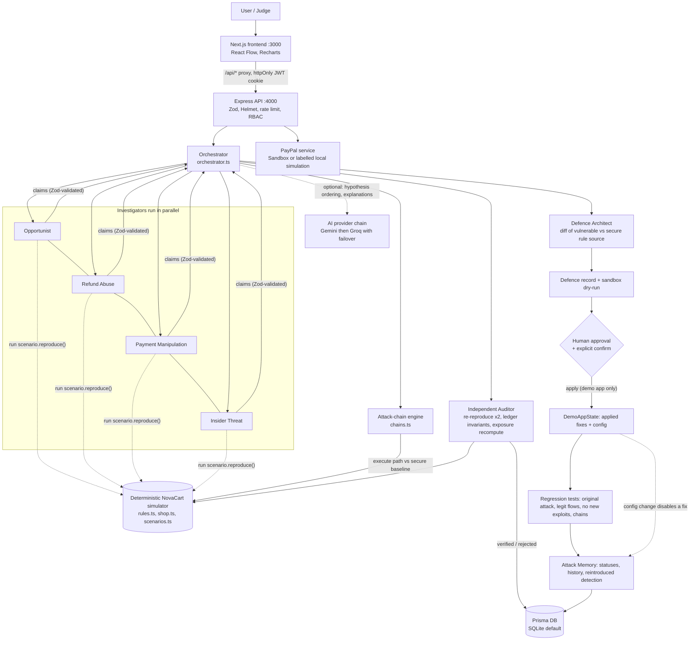

# System Architecture

Verified against the source in `backend/src` and `frontend/app` (2026-11-08).

## Components
| Component | Files | Notes |
|---|---|---|
| Frontend | `frontend/app/**`, `components/` | 12 routes; relative imports; polls backend job state every 0.7–1 s |
| API | `backend/src/app.ts` | session cookie auth, roles `admin/analyst/viewer`, tenant scoping, `Idempotency-Key` support |
| Orchestrator | `orchestrator.ts` | stages: investigating → correlating → verifying → defending → auditing → completed; also `regression` and `website` modes |
| Agents | `agents.ts` | definitions, Zod schemas, optional AI planning, `auditFinding` |
| Simulator | `simulator/` | business rules in vulnerable + secure variants; 13 scenarios; ledger audit |
| Chains | `simulator/chains.ts` | relationship edges, DFS path generation, execution, graph build |
| Defence | `defence.ts`, `simulator/fixes.ts` | patch = unified diff of real source; approve/apply/rollback/test |
| Finance | `finance.ts` | transparent exposure formula |
| PayPal | `paypal.ts` | OAuth cache, Orders, captures, refunds, webhook verification, dedupe |
| Security | `security.ts` | SSRF-safe fetch, crawler, upload validation |
| Reports | `reports.ts` | JSON + PDF (pdfkit) |

## Execution model
Jobs are asynchronous but **in-process**: state is written to `Assessment`/`AgentRun` rows after every step, the UI polls them. A server restart marks running assessments failed. No queue/Redis (the `REDIS_URL` variable is unused).

## Data model
Prisma models: User, Merchant, DemoAppState, UploadedDocument, Assessment, AgentRun, Vulnerability (unique per merchant+test case), AttackChain, AttackStep, Defence, RegressionTest, SandboxTransaction, WebhookEvent (unique `eventId`), IdempotencyKey, AttackMemory, Report, AuditLog. `prisma/schema.postgres.prisma` is the same schema with the PostgreSQL provider — **untested**.

## Vulnerability lifecycle
`detected → verified | rejected` (Auditor) → `fixed` (defence tests passed) → `resolved` (re-scan no longer reproduces, or manual) → `reintroduced` (reproduces again after being fixed/resolved). Rolling back a fix returns the vulnerability to `verified`.
